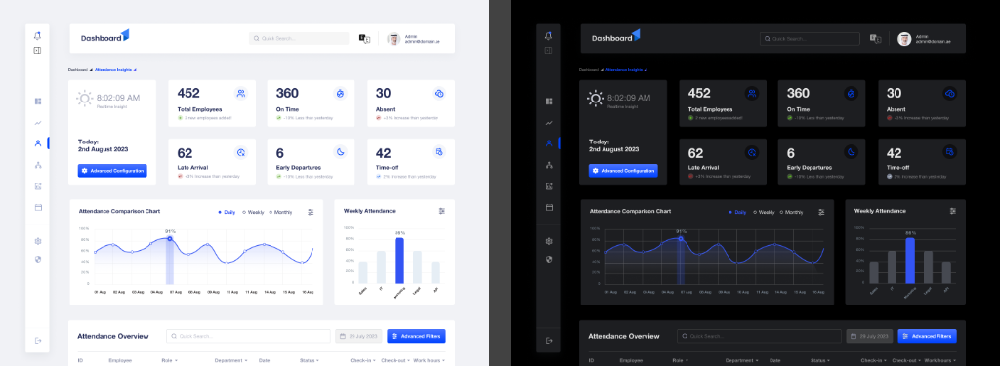
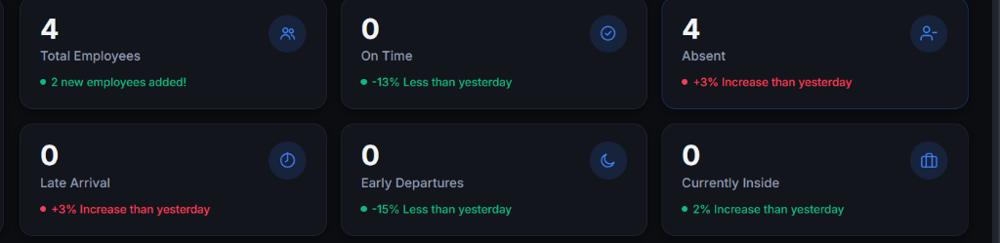
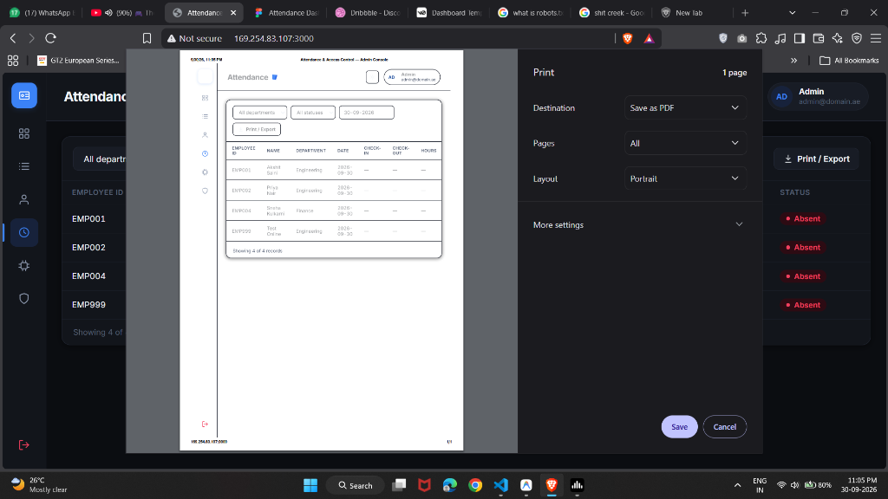
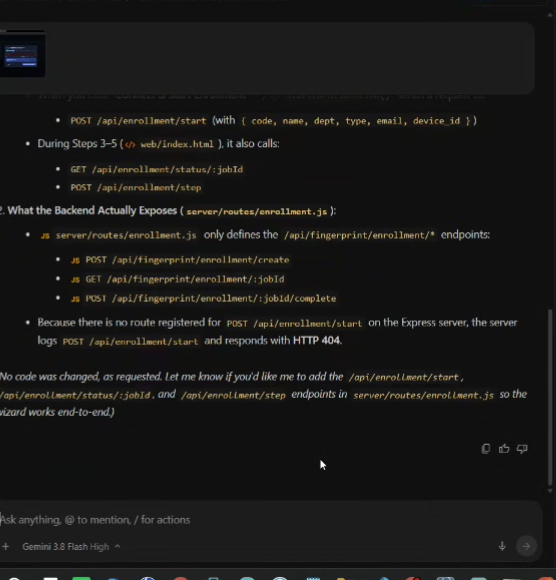
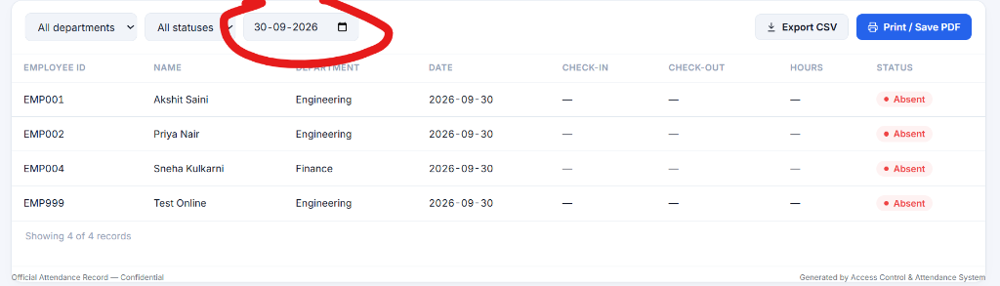

# 🏢 RFID + Fingerprint Attendance & Access Control System

[](https://nodejs.org/)
[](https://expressjs.com/)
[](https://www.postgresql.org/)
[](https://react.dev/)
[](https://espressif.com/)
[-FF6C37?style=flat)](https://developer.mozilla.org/en-US/docs/Web/API/Server-sent_events)
[](LICENSE)

An enterprise-grade, end-to-end IoT Access Control and Automated Attendance Management System. The platform connects physical edge hardware readers (**ESP32**, **PN532 RFID/NFC**, and **R307S Optical Fingerprint**) to a high-concurrency **Node.js/Express REST API**, an immutable append-only **PostgreSQL** audit ledger, and a reactive single-page **React Dashboard** with real-time live event streaming.

---

## 📸 Visual Showcase & Dashboard Previews

### 1. Live Management Dashboard & Operational Overview
The command center displays live occupancy count, system health, daily scan statistics, real-time clock synchronization, and 6-month comparative attendance trends.



---

### 2. Real-Time Scan Feeds & Live Activity Stream
Sub-second live activity feeds powered by **Server-Sent Events (SSE)**. Scans are evaluated instantly by the decision engine and pushed directly to the dashboard with zero polling latency.



---

### 3. Automated Attendance Analytics & Payroll CSV Export
Daily attendance calculation computing first-in, last-out, total work hours, grace periods, and late arrival flags with one-click CSV export for payroll.



---

### 4. Installed Doors & Hardware Reader Registry
Manage physical access points across rooms, monitor real-time reader health heartbeats, designation purposes (`DOOR` vs `ATTENDANCE`), and active biometric access rules.

| Hardware Device Registry | Calendar & Historical Date Navigator |
|:---:|:---:|
|  |  |

---

## 🏛 System Architecture & Data Flow

```
                                  ┌────────────────────────────────────────────────────────┐
                                  │                  PostgreSQL Database                   │
                                  │  - Append-Only Access Logs (DB Trigger Enforced)       │
                                  │  - Credential & Biometric Template Vault               │
                                  │  - Shift Schedules, Doors, & Access Rules Views        │
                                  └───────────────────────────▲────────────────────────────┘
                                                              │ SQL Connection Pool
                                                              │ (pg library)
                                  ┌───────────────────────────▼────────────────────────────┐
                                  │                Node.js / Express API                   │
                                  │  - Sub-15ms Rule Decision Engine                       │
                                  │  - JWT / HMAC Session Authentication                   │
                                  │  - Real-Time Event Bus (Server-Sent Events / SSE)      │
                                  │  - Hardware Adapter (Authenticate / Sync / Log)        │
                                  │  - Zod Request Schema Validation                       │
                                  └──────────────▲──────────────────────────▲──────────────┘
                                                 │                          │
                 HTTP REST / Sync (Port 3000)    │                          │ SSE / JSON REST
                                                 │                          │
    ┌────────────────────────────────────────────┴────────┐   ┌─────────────┴────────────────────────────┐
    │              Edge Hardware (ESP32)                  │   │           Web Administration Console     │
    │  - PN532 NFC/RFID Reader (HSU / UART)               │   │  - Real-time live scan monitoring        │
    │  - R307S Fingerprint Optical Sensor (UART)          │   │  - Employee onboarding & RFID pairing    │
    │  - Offline Cache Fallback (LittleFS Flash Storage)  │   │  - Installed door & reader management    │
    │  - Relay, Status LEDs, and Piezo Buzzer             │   │  - Shift schedules & payroll CSV export  │
    └─────────────────────────────────────────────────────┘   └──────────────────────────────────────────┘
```

### Visual Architecture & Decision Engine Flow
| High-Level Architecture | Decision Engine Flowchart |
|:---:|:---:|
|  |  |

---

## ✨ Key Capabilities

* **⚡ Sub-15ms Policy Decision Engine**:
  * Evaluates incoming RFID card UIDs and biometric fingerprint slots against 7 strict security checkpoints in milliseconds.
  * Validates device activity, credential validity, revocation status, employee status, departmental rules, and biometric requirements.
  * Emits explicit reason codes on denial (`NO_ACCESS_RULE`, `FINGERPRINT_REQUIRED`, `CREDENTIAL_REVOKED`, `UNKNOWN_CARD`).

* **📡 Real-Time Server-Sent Events (SSE)**:
  * Eliminates heavy client polling via unidirectional, persistent HTTP connections.
  * Broadcasts live door taps, occupancy adjustments, and hardware status updates to all active management dashboards instantly.

* **🛡️ Tamper-Proof Append-Only Audit Trail**:
  * The `access_events` database table is strictly append-only.
  * Protected by custom PostgreSQL database triggers (`trg_events_no_update`) that reject any `UPDATE` or `DELETE` query, guaranteeing legal audit and compliance integrity.

* **🚪 Installed Doors & Multi-Door Management**:
  * Organize entryways into physical doors (e.g., *Main Entrance*, *Server Room*, *Hardware Lab*).
  * Associate multiple hardware readers with designated operational purposes (`DOOR` entry/exit vs `ATTENDANCE` clock-in).
  * Built-in safety guards preventing accidental deletion of doors with mounted readers or historical audit records.

* **👥 Employee & Dual-Factor Credential Vault**:
  * Map staff members to 13.56 MHz RFID UIDs and optical fingerprint sensor slots.
  * Instant credential revocation, expiration date control, and remote biometric enrollment workflow.

* **⏰ Shift Scheduling & Automated Attendance Analytics**:
  * Configure custom working hours, start/end windows, and grace periods (e.g., 15-minute late threshold).
  * Automated computation of daily first-in, last-out, total hours worked, and late flags via PostgreSQL `v_attendance_days` view.
  * Corporate holiday calendar exemptions and single-click CSV payroll exports.

* **🔌 Edge Hardware Resilience & Offline Caching**:
  * Edge microcontrollers cache approved credentials in LittleFS flash memory.
  * If the local network or Wi-Fi drops, door access continues uninterrupted and batch-syncs scan logs when connectivity resumes.

---

## 🛠 Tech Stack

| Domain | Technology | Description |
|---|---|---|
| **Backend** | **Node.js (v18+) & Express** | RESTful API, async decision engine, and SSE event streaming |
| **Database** | **PostgreSQL 14+** | Relational schema, connection pooling (`pg`), triggers, and views |
| **Frontend** | **React & Tailwind-style CSS** | Reactive SPA with live SSE data binding, zero build-step overhead |
| **Edge Hardware** | **ESP32 Microcontroller** | 32-bit dual-core Wi-Fi & Bluetooth microcontroller |
| **Peripherals** | **PN532 RFID / R307S Fingerprint** | 13.56MHz contactless reader & optical biometric sensor |
| **Security** | **HMAC Tokens & Bcrypt** | Cryptographic token verification and salted password hashing |
| **Validation** | **Zod** | Runtime request body schema validation |

---

## 📁 Repository Structure

```
├── db/
│   ├── 01_schema.sql            # Core PostgreSQL schema, enum types, triggers, views
│   ├── 02_seed.sql              # Initial system seed data (sample employees, doors, credentials)
│   └── 03_admin_entities.sql    # Shifts, departments, and holiday definitions
├── docs/
│   └── screenshots/             # High-resolution dashboard and architecture images
├── firmware/
│   ├── esp32_test2.ino          # Full ESP32 edge controller firmware
│   └── esp32_pn532_r307s_...    # Pinout, buzzer, LED, and relay configuration
├── server/
│   ├── routes/
│   │   ├── admin.js             # Staff, credentials, rules, doors, shifts, holidays
│   │   ├── device.js            # Device status & registration
│   │   ├── hardware_adapter.js  # Edge firmware compatibility layer (authenticate/sync/log)
│   │   ├── reads.js             # Attendance records and event query routes
│   │   ├── stream.js            # Server-Sent Events (SSE) live push engine
│   │   └── enrollment.js        # Remote biometric enrollment workflow
│   ├── auth.js                  # JWT/HMAC token signing & role guards
│   ├── bus.js                   # In-memory pub/sub event bus
│   ├── db.js                    # PostgreSQL connection pool client
│   ├── decision.js              # Access rule policy decision engine
│   └── index.js                 # Express server bootstrap
├── tools/
│   ├── simulate_device.cjs      # Hardware simulation script for automated testing
│   └── hash_password.js        # Bcrypt administrative password hasher
├── web/
│   └── index.html               # Live management dashboard (React SPA)
├── API.md                       # Comprehensive API contract specification
├── HARDWARE_SETUP.md            # Hardware wiring, pinout & assembly guide
└── README.md                    # Project documentation
```

---

## 🚀 Step-by-Step Installation & Setup

### Prerequisites
* **Node.js** (v18.0.0 or higher)
* **PostgreSQL** (v14 or higher running locally or remotely)
* **Git**

---

### 1. Clone the Repository

```bash
git clone https://github.com/akshit14243/RFID-Fingerprint-Attendance-and-Access-Control-System.git
cd RFID-Fingerprint-Attendance-and-Access-Control-System
```

---

### 2. Database Initialization

Execute the database initialization scripts in sequence using `psql`:

```bash
# 1. Base Schema (Tables, triggers, enums, views, and audit constraints)
psql -U postgres -f db/01_schema.sql

# 2. Seed Data (Initial rooms, sample staff, credentials, and test scans)
psql -U postgres -f db/02_seed.sql

# 3. Extended Management Entities (Departments, shifts, and holidays)
psql -U postgres -f db/03_admin_entities.sql
```

---

### 3. Backend Server Configuration

Navigate to the `server/` directory and install dependencies:

```bash
cd server
npm install
```

Create a `.env` file inside the `server/` folder (or copy from `.env.example`):

```env
# Database Credentials
DB_HOST=127.0.0.1
DB_PORT=5432
DB_USER=postgres
DB_PASSWORD=your_postgres_password
DB_NAME=access_control

# Server & Security
PORT=3000
AUTH_SECRET=your_super_secret_session_key_min_32_chars
DELETE_PASSWORD=ADMIN@DELETE#2026

# Feature Flags
LEGACY_SYNC_ENABLED=false
```

Start the server:

```bash
# Production mode
npm start

# Development mode
node index.js
```

The Web Console and API will now be live at:  
👉 **`http://localhost:3000`**

---

## 🔐 Default Access Credentials

| Role | Email | Password | Permissions |
|---|---|---|---|
| **System Administrator** | `admin@example.com` | `admin123` | Full access (CRUD on staff, credentials, rules, doors, shifts, devices) |
| **Auditor / Viewer** | `viewer@example.com` | `admin123` | Read-only access to live feed, logs, and attendance reports |

---

## 📡 Hardware & Firmware Integration

The backend provides high-performance adapter endpoints designed for edge microcontrollers:

| Endpoint | Method | Purpose |
|---|---|---|
| `/access_control/authenticate.php` | `GET` | Authenticates scanned RFID UID or fingerprint slot against door access rules |
| `/access_control/sync.php` | `GET` | Fetches active allow-list for LittleFS edge cache storage |
| `/access_control/log_access.php` | `GET` | Edge hardware logs entry/exit scans with direction & timestamp |
| `/api/hardware/scan` | `POST` | Native JSON payload scan endpoint for modern IoT readers |

### ESP32 Pinout & Wiring Overview

| Peripheral | Protocol | ESP32 Pins | Description |
|---|---|---|---|
| **PN532 RFID/NFC** | HSU (UART) | TX: `GPIO 16`, RX: `GPIO 17` | High-speed UART mode (DIP switch: `0 1`) |
| **R307S Fingerprint** | Serial2 (UART) | TX: `GPIO 18`, RX: `GPIO 19` | 57600 default baud rate |
| **Relay Module** | Digital Out | `GPIO 26` | Active LOW trigger for 12V maglock / door strike |
| **Piezo Buzzer** | Digital Out | `GPIO 27` | Beep confirmation on allowed / warning on denied |
| **Status LEDs** | Digital Out | Green: `GPIO 25`, Red: `GPIO 33` | Visual authorization indicators |

---

## 🧪 Testing Without Physical Hardware

You can simulate device taps, edge caching, and offline batch syncs using the built-in test suite:

```bash
# Simulate 5 real-time authorized and denied taps
node tools/simulate_device.cjs --loop 5

# Simulate offline device operation followed by batch sync
node tools/simulate_device.cjs --offline 4

# Test scan deduplication engine
node tools/simulate_device.cjs --replay
```

---

## 📜 Project Background & Attribution

This project was engineered as part of the **Project Execution Program** at **ZenV Quantum, Hyderabad** (powered by **Zencube**).  
* **Title:** *RFID + Fingerprint Attendance and Access Control System for Offices*  
* **Credential ID:** `CERT-NAN-2026-ZRUN-0019-ZENV-2026SEP-ACCESSPRO-007`  

---

## 📄 License

This project is licensed under the MIT License — see the [LICENSE](LICENSE) file for details.
