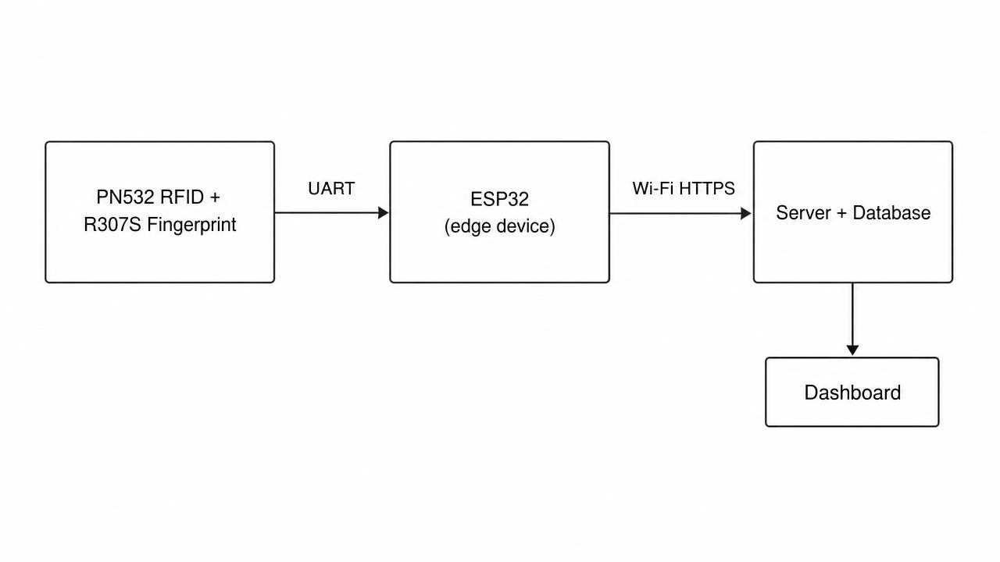
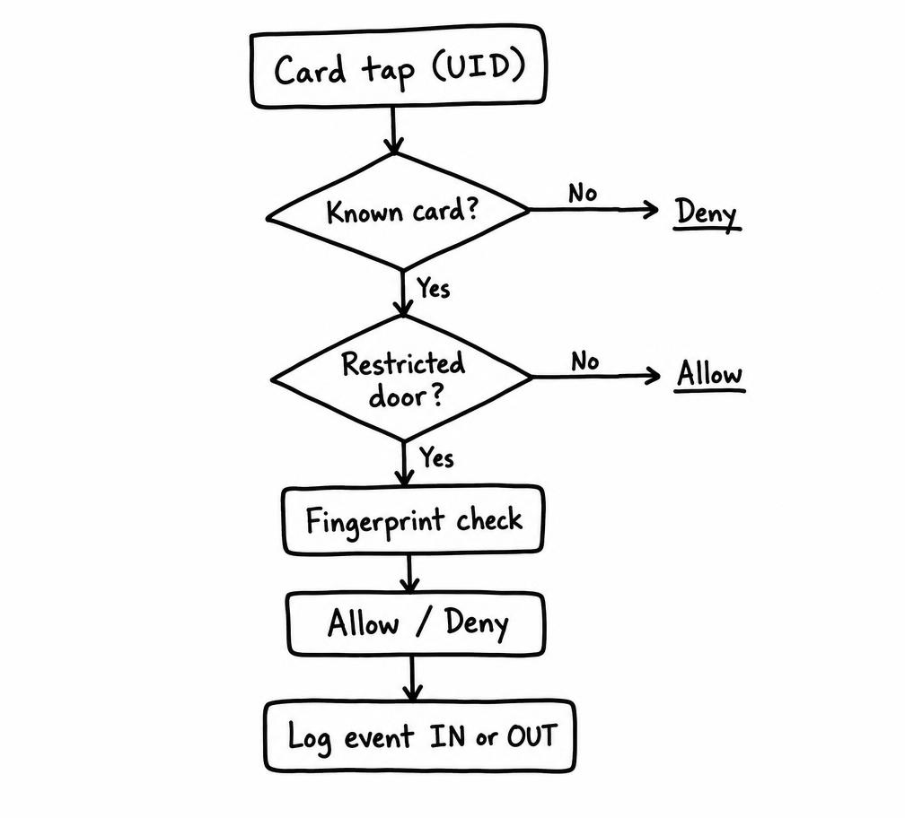

# RFID + Fingerprint Attendance and Access Control System

[](https://nodejs.org/)
[](https://expressjs.com/)
[](https://www.postgresql.org/)
[](https://react.dev/)
[](https://espressif.com/)
[-FF6C37?style=flat)](https://developer.mozilla.org/en-US/docs/Web/API/Server-sent_events)
[](LICENSE)

An enterprise-grade, end-to-end IoT Access Control and Automated Attendance Management System. The platform connects physical edge hardware readers (**ESP32**, **PN532 RFID/NFC**, and **R307S Optical Fingerprint**) with a high-concurrency **Node.js/Express REST API**, an immutable append-only **PostgreSQL** audit ledger, and a reactive single-page **React Dashboard** with real-time live event streaming.

---

## 🎯 The Core Problem & Architectural Objectives

Traditional office badge systems record card interactions rather than human accountability. This architecture was designed by translating foundational security and operational pain points into explicit software specifications:

| Operational Problem | Underlying Failure | Architectural Solution |
|---|---|---|
| **No exit tracking** | Attendance is only half-recorded | State machine determines direction (`IN` vs `OUT`) per event |
| **No fire drill accounting** | Zero real-time visibility | Centralized server tracks live office occupancy in real time |
| **Proxy / buddy punching** | A card UID is not a human | Multi-factor verification (RFID tap + optical fingerprint matching) |
| **All cards unlock all doors** | Absence of authorization layers | Per-room, per-department policy engine; high-security zones require 2FA |
| **Dangling credentials** | Stale permissions and contractor access | Time-delimited credentials with automatic expiration and instant revocation |

> *Core Principle: A card swipe proves only that a plastic token touched a reader — not who carried it, not which direction they moved, and not whether they had authorization. This system establishes verifiable human identity and immutable auditability.*

---

## 🏛 System Sketches & Architecture

### System Architecture


### Door Decision Flow


---

### Data Flow Diagram

```
                                  ┌────────────────────────────────────────────────────────┐
                                  │                  PostgreSQL Database                   │
                                  │  - Append-Only Access Logs (DB Trigger Enforced)       │
                                  │  - Credential & Biometric Template Vault               │
                                  │  - Shift Schedules, Doors, & Access Rules Views        │
                                  └───────────────────────────▲────────────────────────────┘
                                                              │ SQL Connection Pool
                                                              │ (pg library)
                                  ┌───────────────────────────▼────────────────────────────┐
                                  │                Node.js / Express API                   │
                                  │  - Sub-15ms Rule Decision Engine                       │
                                  │  - JWT / HMAC Session Authentication                   │
                                  │  - Real-Time Event Bus (Server-Sent Events / SSE)      │
                                  │  - Hardware Adapter (Authenticate / Sync / Log)        │
                                  │  - Zod Request Schema Validation                       │
                                  └──────────────▲──────────────────────────▲──────────────┘
                                                 │                          │
                 HTTP REST / Sync (Port 3000)    │                          │ SSE / JSON REST
                                                 │                          │
    ┌────────────────────────────────────────────┴────────┐   ┌─────────────┴────────────────────────────┐
    │              Edge Hardware (ESP32)                  │   │           Web Administration Console     │
    │  - PN532 NFC/RFID Reader (HSU / UART)               │   │  - Real-time live scan monitoring        │
    │  - R307S Fingerprint Optical Sensor (UART)          │   │  - Employee onboarding & RFID pairing    │
    │  - Offline Cache Fallback (LittleFS Flash Storage)  │   │  - Installed door & reader management    │
    │  - Relay, Status LEDs, and Piezo Buzzer             │   │  - Shift schedules & payroll CSV export  │
    └─────────────────────────────────────────────────────┘   └──────────────────────────────────────────┘
```

---

## ✨ Key Capabilities & Engineering Highlights

* **⚡ Sub-15ms Policy Decision Engine (`server/decision.js`)**:
  * Evaluates incoming RFID card UIDs and biometric fingerprint slots against 7 strict security checkpoints in milliseconds.
  * Checks device activity, credential validity, revocation status, employee active status, departmental rules, and biometric requirements.
  * Returns explicit denial reason codes (`NO_ACCESS_RULE`, `FINGERPRINT_REQUIRED`, `CREDENTIAL_REVOKED`, `UNKNOWN_CARD`).

* **📡 Real-Time Server-Sent Events (`server/routes/stream.js`)**:
  * Broadcasts door taps, live room occupancy changes, and device heartbeats over persistent HTTP connections.
  * Delivers sub-second updates to the management dashboard without client-side polling.

* **🛡️ Append-Only Tamper-Proof Audit Ledger (`db/01_schema.sql`)**:
  * The `access_events` database table is strictly append-only.
  * Enforced by a custom PostgreSQL database trigger (`trg_events_no_update`) that raises exceptions on any `UPDATE` or `DELETE` statement, guaranteeing audit and compliance integrity.

* **🚪 Multi-Door & Hardware Reader Management**:
  * Organize entryways into physical access points (e.g., *Main Entrance*, *Server Room*, *Hardware Lab*).
  * Associate hardware readers with specific purposes (`DOOR` entry/exit vs `ATTENDANCE` clock-in).
  * Built-in safety checks prevent accidental deletion of doors with active mounted devices or audit history.

* **⏰ Shift Schedules & Automated Attendance Calculation**:
  * Configure custom working hours, start/end windows, and grace periods (e.g., 15-minute late threshold).
  * Automated computation of daily first-in, last-out, total hours worked, and late flags via PostgreSQL `v_attendance_days` view.
  * Corporate holiday exemptions and single-click CSV export for payroll.

* **🔌 Edge Hardware Resilience & Offline Caching**:
  * Microcontrollers cache authorized credentials locally in LittleFS flash memory.
  * If local Wi-Fi drops, door access continues offline and batch-syncs access logs upon reconnection.

---

## 🛠 Key Hardware Decisions & Pinout

* **PN532 on UART2 (HSU)** at 115200 baud, DIP switches set to HSU mode. High-speed UART avoids I2C bus lockups.
* **R307S Fingerprint on UART1** at its default 57600 baud.
* **UART0 remains dedicated** to the USB serial console for runtime debugging and flashing.
* **Avoided GPIO 34–39** (input-only pins, cannot drive relays) and **GPIO 6–11** (connected to SPI flash).

### Pin Wiring Reference

| Peripheral | Protocol | ESP32 Pins | Description |
|---|---|---|---|
| **PN532 RFID/NFC** | HSU (UART) | TX: `GPIO 16`, RX: `GPIO 17` | High-speed UART mode (DIP switch: `0 1`) |
| **R307S Fingerprint** | Serial2 (UART) | TX: `GPIO 18`, RX: `GPIO 19` | 57600 default baud rate |
| **Relay Module** | Digital Out | `GPIO 26` | Active LOW trigger for 12V maglock / door strike |
| **Piezo Buzzer** | Digital Out | `GPIO 27` | Beep confirmation on allowed / warning on denied |
| **Status LEDs** | Digital Out | Green: `GPIO 25`, Red: `GPIO 33` | Visual authorization indicators |

---

## 📁 Repository Layout

```
├── db/
│   ├── 01_schema.sql            # Core PostgreSQL schema, enum types, triggers, views
│   ├── 02_seed.sql              # Initial system seed data (sample employees, doors, credentials)
│   └── 03_admin_entities.sql    # Shifts, departments, and holiday definitions
├── firmware/
│   ├── esp32_test2.ino          # Complete ESP32 edge controller firmware
│   └── esp32_pn532_r307s_...    # Pinout, buzzer, LED, and relay configuration
├── images/
│   ├── system_architecture.jpg  # System architecture sketch
│   └── decision_flow.jpg        # Door decision logic flowchart
├── notes/
│   ├── reading-notes.md         # Architecture and hardware study notes
│   ├── resources.md             # Protocols, library datasheets, and reference links
│   └── wiring-and-baud.md       # Pinout selection rationale and serial configuration
├── server/
│   ├── routes/
│   │   ├── admin.js             # Staff, credentials, rules, doors, shifts, holidays
│   │   ├── device.js            # Device status & registration
│   │   ├── hardware_adapter.js  # Edge firmware compatibility layer (authenticate/sync/log)
│   │   ├── reads.js             # Attendance records and event query routes
│   │   ├── stream.js            # Server-Sent Events (SSE) live push engine
│   │   └── enrollment.js        # Remote biometric enrollment workflow
│   ├── auth.js                  # JWT/HMAC token signing & role guards
│   ├── bus.js                   # In-memory pub/sub event bus
│   ├── db.js                    # PostgreSQL connection pool client
│   ├── decision.js              # Access rule policy decision engine
│   └── index.js                 # Express server bootstrap
├── tools/
│   ├── simulate_device.cjs      # Hardware simulation script for automated testing
│   └── hash_password.js        # Bcrypt administrative password hasher
├── web/
│   └── index.html               # Live management dashboard (React SPA)
├── API.md                       # Comprehensive API contract specification
├── HARDWARE_SETUP.md            # Hardware wiring, pinout & assembly guide
└── README.md                    # Project documentation
```

---

## 🚀 Installation & Quick Start

### Prerequisites
* **Node.js** (v18.0.0 or higher)
* **PostgreSQL** (v14 or higher running locally or remotely)
* **Git**

---

### 1. Database Initialization

Execute the database initialization scripts in sequence using `psql`:

```bash
# 1. Base Schema (Tables, triggers, enums, views, and audit constraints)
psql -U postgres -f db/01_schema.sql

# 2. Seed Data (Initial rooms, sample staff, credentials, and test scans)
psql -U postgres -f db/02_seed.sql

# 3. Extended Management Entities (Departments, shifts, and holidays)
psql -U postgres -f db/03_admin_entities.sql
```

---

### 2. Backend Server Setup

Navigate to the `server/` directory and install dependencies:

```bash
cd server
npm install
```

Create a `.env` file inside the `server/` directory:

```env
# Database Credentials
DB_HOST=127.0.0.1
DB_PORT=5432
DB_USER=postgres
DB_PASSWORD=your_postgres_password
DB_NAME=access_control

# Server & Security
PORT=3000
AUTH_SECRET=your_super_secret_session_key_min_32_chars
DELETE_PASSWORD=ADMIN@DELETE#2026

# Feature Flags
LEGACY_SYNC_ENABLED=false
```

Start the application:

```bash
# Production mode
npm start

# Development mode
node index.js
```

The Web Administration Console will now be live at:  
👉 **`http://localhost:3000`**

---

## 🔐 Default Access Credentials

| Role | Email | Password | Permissions |
|---|---|---|---|
| **System Administrator** | `admin@example.com` | `admin123` | Full access (CRUD on staff, credentials, rules, doors, shifts, devices) |
| **Auditor / Viewer** | `viewer@example.com` | `admin123` | Read-only access to live feed, logs, and attendance reports |

---

## 🧪 Testing Without Physical Hardware

You can simulate device taps, edge caching, and offline batch syncs using the built-in test runner:

```bash
# Simulate 5 real-time authorized and denied taps
node tools/simulate_device.cjs --loop 5

# Simulate offline device operation followed by batch sync
node tools/simulate_device.cjs --offline 4

# Test scan deduplication engine
node tools/simulate_device.cjs --replay
```

---

## 📜 Project Background & Attribution

This project was engineered as part of the **Project Execution Program** at **ZenV Quantum, Hyderabad** (powered by **Zencube**).  
* **Title:** *RFID + Fingerprint Attendance and Access Control System for Offices*  
* **Credential ID:** `CERT-NAN-2026-ZRUN-0019-ZENV-2026SEP-ACCESSPRO-007`  
* **Author:** Akshit Saini  

---

## 📄 License

This project is licensed under the MIT License — see the [LICENSE](LICENSE) file for details.
